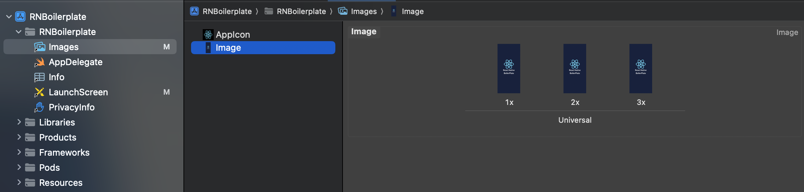
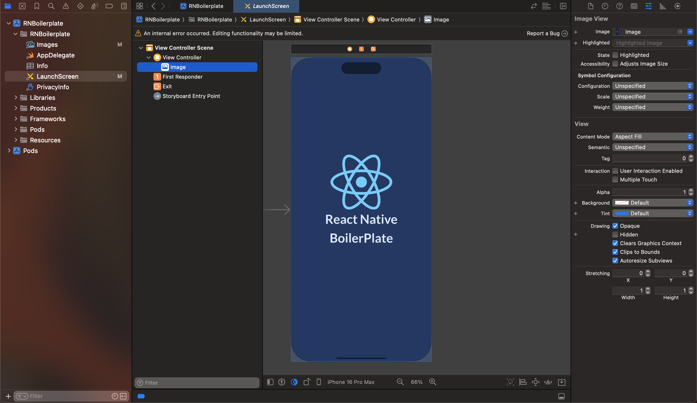

# React Native Boilerplate

<p align="center">
   
</p>

This project is a React Native boilerplate designed to help you kickstart your mobile app development quickly and efficiently. It provides a well-structured foundation with best practices, pre-configured navigation, state management, theming, and a collection of reusable components. Whether you're building a new app or looking to standardize your team's workflow, this boilerplate aims to save you time and effort by handling the initial setup and common patterns out of the box.

## ✨ Features

• Scalable folder architecture for large React Native apps  
• Pre-configured navigation and screen structure  
• Reusable UI component library (20+ components)  
• Light / dark / system theming via `ThemeProvider`, `useTheme`, and `useStyles`  
• Form handling with validation support  
• Responsive scaling utilities for consistent layouts  
• Clean screen layout standard for maintainable code  
• Optimized developer workflow and reusable patterns

Here are the components which are available in the Boilerplate:

1. [App Header](src/components/app-header/index.tsx)
2. [Avatar](src/components/avatar/index.tsx)
3. [Button](src/components/button/index.tsx)
4. [Calender Input](src/components/calender-input/index.tsx)
5. [Drop Down Menu](src/components/drop-down-menu/index.tsx)
6. [Image/Video Picker](src/components/image-video-picker/index.tsx)
7. [Input](src/components/input/index.tsx)
8. [List Footer Component](src/components/list-footer-component/index.tsx)
9. [Loader](src/components/loader/index.tsx)
10. [Modal Wrapper](src/components/modal-wrapper/index.tsx)
11. [OTP Input](src/components/otp-input/index.tsx)
12. [Radio Selection](src/components/radio-selection/index.tsx)
13. [Range Slider](src/components/range-slider/index.tsx)
14. [Screen Wrapper](src/components/screen-wrapper/index.tsx)
15. [Search Input](src/components/search-input/index.tsx)
16. [Shadow Card](src/components/shadow-card/index.tsx)
17. [Skeleton Loader](src/components/skeleton-loader/index.tsx)
18. [Slow NetWork Message](src/components/slow-network-message/index.tsx)
19. [State Wrapper](src/components/state-wrapper/index.tsx)
20. [Switch Button](src/components/switch-button/index.tsx)
21. [Tab Switch](src/components/tab-switch/index.tsx)
22. [Text](src/components/text/index.tsx)
23. [Vector Icon](src/components/vector-icon/index.tsx)

## File Layout Standards

To keep screens and components consistent, follow the sectioned layout demonstrated in [`src/screens/auth/login/index.tsx`](src/screens/auth/login/index.tsx). Add only the sections you actually need, keeping them in this order:

```7:65:src/screens/auth/login/index.tsx
// Screen params
// Theme (useTheme) / mode (selectedMode)
// Selectors and event dispatchers
// Refs
// States
// Hook form
// Query Hooks
// Imperative handlers
// useEffects, callBacks and memos
// Helper functions
// Api call Functions
// Render functions
```

If your feature introduces recurring sections, extend this list and keep the documentation updated so the pattern stays universal.

## Responsive Scaling Utilities Guide

A comprehensive guide for using responsive scaling functions in React Native applications.

### Overview

This utility library provides functions to create responsive layouts that adapt to different screen sizes and aspect ratios. All scaling is based on a design reference device (iPhone X: 375×812px).

---

### Quick Reference

| Function              | Primary Use Case           | Example                                    |
| --------------------- | -------------------------- | ------------------------------------------ |
| `textSize()`          | Font sizes                 | `fontSize: textSize(2)`                    |
| `horizontalSpacing()` | Horizontal margins/padding | `paddingHorizontal: horizontalSpacing(16)` |
| `verticalSpacing()`   | Vertical margins/padding   | `marginVertical: verticalSpacing(24)`      |
| `width()`             | Component widths (%)       | `width: width(90)`                         |
| `height()`            | Component heights (%)      | `height: height(50)`                       |
| `scaleHorizontal()`   | Exact horizontal scaling   | `width: scaleHorizontal(200)`              |
| `scaleVertical()`     | Exact vertical scaling     | `height: scaleVertical(100)`               |

---

### Detailed Function Guide

<details>

#### 📱 `textSize(percent)`

**When to use:**

- All font sizes (headings, body text, labels, captions)
- Typography that needs to scale across devices
- Text-based UI elements

**Why this function:**

- Automatically adjusts for tall aspect ratios (18.5:9, 20:9)
- Prevents text from becoming too large on modern phones
- More reliable than vertical scaling for readability

**Usage:**

```javascript
// Headings
fontSize: textSize(3); // ~24px on reference device

// Body text
fontSize: textSize(2); // ~16px on reference device

// Small text
fontSize: textSize(1.5); // ~12px on reference device

// Large headings
fontSize: textSize(4); // ~32px on reference device
```

**❌ Don't use:**

- Don't use `scaleVertical()` for fonts
- Don't use for icon sizes (use `horizontalSpacing()` instead)

---

#### ↔️ `horizontalSpacing(size, factor = 0.5)`

**When to use:**

- Horizontal margins and padding
- Space between horizontally arranged items
- Button spacing
- Card horizontal padding
- Icon sizes
- Border radius

**Why this function:**

- Moderate scaling prevents excessive spacing on large devices
- Default factor (0.5) provides balanced scaling
- More flexible than full `scaleHorizontal()`

**Usage:**

```javascript
// Default moderate scaling (factor = 0.5)
paddingHorizontal: horizontalSpacing(16);
marginHorizontal: horizontalSpacing(20);

// More aggressive scaling (factor = 0.7)
borderRadius: horizontalSpacing(12, 0.7);

// Minimal scaling (factor = 0.3)
gap: horizontalSpacing(8, 0.3);

// Button padding
paddingHorizontal: horizontalSpacing(24);
```

**Recommended for:**

- Standard margins: `horizontalSpacing(16)`
- Large padding: `horizontalSpacing(24)`
- Small spacing: `horizontalSpacing(8)`
- Icon sizes: `horizontalSpacing(24)`

---

#### ↕️ `verticalSpacing(size, factor = 0.5)`

**When to use:**

- Vertical margins and padding
- Section spacing
- List item spacing
- Space between vertically stacked components
- Card vertical padding

**Why this function:**

- Prevents excessive vertical spacing on tall devices
- Maintains visual balance across screen heights
- Default factor (0.5) works well for most cases

**Usage:**

```javascript
// Default moderate scaling (factor = 0.5)
paddingVertical: verticalSpacing(16);
marginVertical: verticalSpacing(24);

// Section spacing
marginBottom: verticalSpacing(32);

// List item spacing
gap: verticalSpacing(12);

// Screen padding
paddingTop: verticalSpacing(20);
paddingBottom: verticalSpacing(20);
```

**Recommended for:**

- Standard margins: `verticalSpacing(16)`
- Section gaps: `verticalSpacing(24)` or `verticalSpacing(32)`
- Small spacing: `verticalSpacing(8)`

---

#### 📏 `width(percentage)`

**When to use:**

- Component widths based on screen percentage
- Responsive card layouts
- Full-width or partial-width components
- Centering content with specific width

**Why this function:**

- Simple percentage-based calculations
- Easy to understand and maintain
- Perfect for responsive grid layouts

**Usage:**

```javascript
// Full width
width: width(100);

// 90% width (with 5% margins on each side)
width: width(90);

// Half width
width: width(50);

// Card in grid
width: width(45); // Two cards per row with spacing

// Modal content
width: width(85);
```

**Common patterns:**

```javascript
// Full-width card with margins
{
  width: width(90),
  alignSelf: 'center'
}

// Two-column grid
{
  width: width(48),  // Leaves 4% for gap
  marginHorizontal: '1%'
}
```

---

#### 📐 `height(percentage)`

**When to use:**

- Modals and bottom sheets
- Hero sections
- Full-screen or partial-height components
- Image containers with aspect ratio needs

**Why this function:**

- Percentage-based height calculations
- Useful for overlay components
- Good for defining maximum heights

**Usage:**

```javascript
// Full screen
height: height(100);

// Bottom sheet
height: height(60);

// Modal
height: height(70);

// Hero image
height: height(40);

// Image preview
maxHeight: height(50);
```

**⚠️ Use with caution:**

- Avoid for small components (can break on very small screens)
- Consider combining with `minHeight` and `maxHeight`

---

#### ↔️ `scaleHorizontal(size)`

**When to use:**

- Exact proportional horizontal scaling needed
- Fixed-width components that must scale perfectly
- When moderate scaling is too conservative

**Why this function:**

- Full proportional scaling based on screen width
- Maintains exact design proportions
- Use sparingly for specific cases

**Usage:**

```javascript
// Component width that must scale exactly
width: scaleHorizontal(200);

// Horizontal dimensions
marginLeft: scaleHorizontal(20);

// Image width
width: scaleHorizontal(120);
```

**❌ Avoid using for:**

- Font sizes (use `textSize()`)
- General spacing (use `horizontalSpacing()`)

---

#### ↕️ `scaleVertical(size)`

**When to use:**

- Exact proportional vertical scaling needed
- Fixed-height components that must scale perfectly
- When moderate scaling is too conservative

**Why this function:**

- Full proportional scaling based on screen height
- Maintains exact design proportions
- Use sparingly for specific cases

**Usage:**

```javascript
// Component height that must scale exactly
height: scaleVertical(200);

// Vertical dimensions
marginTop: scaleVertical(30);

// Image height
height: scaleVertical(150);
```

**❌ Avoid using for:**

- Font sizes (use `textSize()`)
- General spacing (use `verticalSpacing()`)
- Tall devices (can cause excessive spacing)

---

### 🎯 Decision Tree

Use this flowchart to decide which function to use:

```
Is it a FONT SIZE?
├─ YES → textSize()
└─ NO ↓

Is it WIDTH/HEIGHT as a PERCENTAGE of screen?
├─ YES → width() or height()
└─ NO ↓

Is it HORIZONTAL spacing/margin/padding?
├─ YES → horizontalSpacing() (default)
│         └─ Need exact scaling? → scaleHorizontal()
└─ NO ↓

Is it VERTICAL spacing/margin/padding?
├─ YES → verticalSpacing() (default)
│         └─ Need exact scaling? → scaleVertical()
└─ NO ↓

Use absolute values or flexbox
```

---

### 📋 Complete Example

```javascript
import {
  textSize,
  horizontalSpacing,
  verticalSpacing,
  width,
  height,
  scaleHorizontal,
} from './responsiveUtils';

const styles = StyleSheet.create({
  container: {
    width: width(90), // 90% of screen width
    paddingHorizontal: horizontalSpacing(16), // Moderate horizontal padding
    paddingVertical: verticalSpacing(20), // Moderate vertical padding
    marginTop: verticalSpacing(24), // Vertical margin
    borderRadius: horizontalSpacing(12, 0.6), // Slightly more scaled border
  },

  title: {
    fontSize: textSize(3), // Large heading
    marginBottom: verticalSpacing(8), // Small vertical space
  },

  body: {
    fontSize: textSize(2), // Body text
    lineHeight: textSize(2.8), // Line height
    marginBottom: verticalSpacing(16), // Paragraph spacing
  },

  button: {
    paddingHorizontal: horizontalSpacing(32), // Button horizontal padding
    paddingVertical: verticalSpacing(12), // Button vertical padding
    borderRadius: horizontalSpacing(8), // Rounded corners
  },

  buttonText: {
    fontSize: textSize(2), // Button text size
  },

  modal: {
    width: width(85), // 85% width modal
    height: height(60), // 60% height modal
    padding: horizontalSpacing(20), // Even padding
  },

  icon: {
    width: horizontalSpacing(24), // Icon size
    height: horizontalSpacing(24), // Keep square
  },

  // When exact scaling is needed
  exactImage: {
    width: scaleHorizontal(200), // Exact proportional width
    height: scaleHorizontal(200), // Keep aspect ratio
  },
});
```

---

### ⚠️ Common Mistakes

#### ❌ Don't do this:

```javascript
// Using scaleVertical for fonts
fontSize: scaleVertical(16); // Will be too large on tall phones

// Using textSize for spacing
marginTop: textSize(2); // Inconsistent with actual spacing needs

// Full scaling for all spacing
padding: scaleHorizontal(20); // Too aggressive on large devices
```

#### ✅ Do this instead:

```javascript
// Use textSize for fonts
fontSize: textSize(2);

// Use spacing functions for spacing
marginTop: verticalSpacing(20);

// Use moderate scaling for spacing
padding: horizontalSpacing(20);
```

---

### 🎨 Design Reference

All scaling is based on:

- **Reference Device:** iPhone X
- **Width:** 375px
- **Height:** 812px
- **Aspect Ratio:** ~2.16:1

When designing in Figma/Sketch, use these dimensions and the utilities will scale appropriately.

---

### 📱 Responsive Behavior

#### Small Phones (< 375px width)

- Components scale down proportionally
- Text remains readable (minimum sizes maintained)

#### Large Phones (> 375px width)

- Moderate scaling prevents excessive growth
- Maintains visual balance

#### Tablets

- Consider using absolute values for some elements
- Test thoroughly as scaling may be aggressive
- May need tablet-specific layouts for best results

#### Tall Aspect Ratios (18.5:9, 20:9+)

- `textSize()` automatically compensates
- Prevents text from becoming too large
- Vertical spacing is moderated automatically

---

### 🔧 Customizing Scaling Factor

Both spacing functions accept an optional `factor` parameter:

```javascript
// Conservative scaling
paddingHorizontal: horizontalSpacing(16, 0.3); // Less scaling

// Default balanced scaling
paddingHorizontal: horizontalSpacing(16); // factor = 0.5

// Aggressive scaling
paddingHorizontal: horizontalSpacing(16, 0.8); // More scaling

// Full proportional scaling
paddingHorizontal: horizontalSpacing(16, 1.0); // Same as scaleHorizontal(16)
```

**Recommended factors:**

- **0.3-0.4:** Minimal scaling for tight designs
- **0.5:** Default, balanced for most use cases
- **0.6-0.7:** More responsive, adapts better to large screens
- **0.8-1.0:** Aggressive, use sparingly

---

### 📊 Testing Checklist

Test your layouts on:

- [ ] Small phone (iPhone SE - 320×568)
- [ ] Standard phone (iPhone X/11 - 375×812)
- [ ] Large phone (iPhone Pro Max - 428×926)
- [ ] Tall phone (21:9 aspect ratio)
- [ ] Android variations (different screen sizes)
- [ ] Tablet (if supporting tablets)

---

### 💡 Best Practices

1. **Start with moderate scaling** - Use `horizontalSpacing()` and `verticalSpacing()` by default
2. **Use textSize() for all fonts** - Never use vertical scaling for typography
3. **Test on multiple devices** - Ensure your design works across screen sizes
4. **Be consistent** - Use the same functions for similar use cases
5. **Don't over-scale** - Not everything needs to scale proportionally
6. **Combine with flexbox** - Use flex properties for truly responsive layouts
7. **Set min/max constraints** - Add `minWidth`, `maxHeight` etc. where appropriate

---

### 🔗 Related Concepts

- **Flexbox:** Use for dynamic layouts that adapt to content
- **Aspect Ratio:** Use for maintaining image/video proportions
- **Platform-specific styles:** Combine with `Platform.select()` when needed
- **Responsive hooks:** Consider using `useWindowDimensions()` for dynamic updates

---

### 📝 Summary

| Scenario                   | Recommended Function                    |
| -------------------------- | --------------------------------------- |
| Font size                  | `textSize()`                            |
| Horizontal spacing         | `horizontalSpacing()`                   |
| Vertical spacing           | `verticalSpacing()`                     |
| Component width (%)        | `width()`                               |
| Component height (%)       | `height()`                              |
| Icon size                  | `horizontalSpacing()`                   |
| Border radius              | `horizontalSpacing()`                   |
| Exact proportional scaling | `scaleHorizontal()` / `scaleVertical()` |

**Remember:** When in doubt, use the moderate scaling functions (`horizontalSpacing`, `verticalSpacing`) with the default factor. They provide the best balance between responsiveness and visual consistency.

</details>

## Getting Started

<details>

Follow these steps to set up and run the project locally:

### Prerequisites

- [Node.js](https://nodejs.org/) (Recommended: latest LTS version)
- [Yarn](https://classic.yarnpkg.com/en/docs/install/) or npm
- [React Native CLI](https://reactnative.dev/docs/environment-setup) (for running on a device/emulator)
- Xcode (for iOS development, macOS only)
- Android Studio (for Android development)

### Installation

1. Clone the repository:
   ```bash
   git clone <your-repo-url>
   cd RNBoilerPlate
   ```
2. Install dependencies:
   ```bash
   yarn install
   # or
   npm install
   ```

### Running on iOS

1. Install CocoaPods dependencies:
   ```bash
   cd ios && pod install && cd ..
   ```
2. Start the Metro bundler:
   ```bash
   yarn start
   # or
   npm run start
   ```
3. In a new terminal, run the app:
   ```bash
   yarn ios
   # or
   npm run ios
   ```

### Running on Android

1. Start the Metro bundler (if not already running):
   ```bash
   yarn start
   # or
   npm run start
   ```
2. In a new terminal, run the app for the environment you want:
   ```bash
   yarn androidDevDebug      # Development
   yarn androidStagingDebug  # Staging
   yarn androidProdDebug     # Production
   ```

</details>

## Code Generators

<details>

Use the built-in generator to scaffold components and screens quickly:

```bash
yarn generate <type> [...args]
```

`type` can be:

- `component`
- `screen`

### Generate a Component

Command:

```bash
yarn generate component <ComponentName>
```

Example:

```bash
yarn generate component UserCard
```

This will:

- Create `src/components/user-card/`
- Add `index.tsx`, `styles.ts`, and `types.ts` inside that folder
- Update `src/components/index.ts` with:
  - `export { default as UserCard } from './user-card';`
- Keep exports in `src/components/index.ts` sorted alphabetically by folder name

Notes:

- Use PascalCase for `<ComponentName>` (for example: `UserCard`, `PrimaryButton`)
- If the component folder already exists, the generator exits with an error

### Generate a Screen

Command:

```bash
yarn generate screen <section> <ScreenName>
```

`section` must be one of:

- `auth`
- `app`
- `global`

Examples:

```bash
yarn generate screen auth TermsAndConditions
yarn generate screen app UserProfile
yarn generate screen global Maintenance
```

This will:

- Create a screen folder in `src/screens/<section>/` using kebab-case
  - Example: `TermsAndConditions` -> `terms-and-conditions`
- Create `index.tsx`, `styles.ts`, `types.ts`, and `validation.ts` in that folder
- Add an export to `src/screens/<section>/index.ts`
- Update `src/routes/routes.ts` by adding:
  - A new `ScreenNames` enum entry
  - A new `RootStackParamList` route mapping with `undefined` params
- Update stack navigators:
  - `auth` section -> `src/routes/auth-stack.tsx`
  - `app` section -> `src/routes/app-stack.tsx`
  - `global` section -> both `src/routes/auth-stack.tsx` and `src/routes/app-stack.tsx`

Naming behavior:

- If `<ScreenName>` ends with `Screen` (case-insensitive), that suffix is removed automatically
  - `ProfileScreen` -> route key based on `Profile`, component becomes `ProfileScreen`
- Generated component name is always `<ScreenName>Screen`

Notes:

- Use PascalCase for `<ScreenName>` (for example: `TermsAndConditions`)
- If the target screen folder already exists, generation fails
- If the route already exists in `src/routes/routes.ts`, generation fails

</details>

## Common Customizations

When starting a new project with this boilerplate, you may want to update or customize the following:

1. [Font family](#changing-the-font-family)
2. [App name and package name](#updating-app-name-and-package-name)
3. [Font colors](#updating-font-colors)
4. [Text variants](#updating-text-variants)
5. [App icons](#updating-app-icons)
6. [Splash screen](#updating-splash-screen)
7. [Theming system](#theming-system)
8. [Custom URL scheme deep linking](#custom-url-scheme-deep-linking)

## Theming System

<details>

The project ships with a strongly typed theming layer that powers palette-level colors and light / dark / system runtime themes.

### Where things live

- Color palette: [`src/theme/app-colors.ts`](src/theme/app-colors.ts)
- Light theme object: [`src/theme/light-theme.ts`](src/theme/light-theme.ts)
- Dark theme object: [`src/theme/dark-theme.ts`](src/theme/dark-theme.ts)
- Theme provider / hook: [`src/theme/provider.tsx`](src/theme/provider.tsx) (`ThemeProvider`, `useTheme`)
- Shared theme types: [`src/theme/types.ts`](src/theme/types.ts) (`AppTheme`, `AppColorsTypes`, `ThemeMode`, fonts, text variants)
- Style helper hook: [`src/hooks/useStyles.ts`](src/hooks/useStyles.ts)
- Export barrel: [`src/theme/index.ts`](src/theme/index.ts)
- Theme mode in Redux: `selectedMode` via [`src/redux/slices/config`](src/redux/slices/config/index.ts) (`light` | `dark` | `system`)

Each color is declared once inside `AppColors`, typed via `AppColorsTypes` in `src/theme/types.ts`, and then consumed by `LightTheme` / `DarkTheme`. Those objects describe semantic slots (text, backgrounds, placeholders, etc.) that the UI reads at runtime.

`ThemeProvider` (wrapped in [`App.tsx`](App.tsx)) resolves the active theme from Redux `selectedMode` and, when mode is `system`, from the device color scheme.

### Adding or updating palette colors

1. Add/edit the hex value inside [`src/theme/app-colors.ts`](src/theme/app-colors.ts).
2. Mirror the change inside [`src/theme/types.ts`](src/theme/types.ts) on `AppColorsTypes` so TypeScript exposes the new key everywhere.
3. Reference the new color inside [`src/theme/light-theme.ts`](src/theme/light-theme.ts) and/or [`src/theme/dark-theme.ts`](src/theme/dark-theme.ts) if a semantic slot (e.g., `primaryBackgroundColor`) should use it.
4. Import and use the color anywhere via `import { AppColors } from '~theme';`.

Example snippet from `AppColors`:

```3:17:src/theme/app-colors.ts
const AppColors: AppColorsTypes = {
  White: '#ffffff',
  // ...
  Warning: '#E97E00',
  whiteGrey: '#DEE2E6',
  white50: 'rgba(255,255,255,0.5)',
  DarkBlue: '#020617',
};
```

### Consuming the active theme in components

Prefer `useTheme()` for theme tokens and `useStyles(createStyles)` when `styles.ts` needs theme-aware colors. Avoid hardcoding colors in `styles.ts`; pass them through the theme.

Typical pattern:

```ts
// styles.ts
import { StyleSheet } from 'react-native';
import { AppTheme } from '~theme';

const createStyles = (theme: AppTheme) =>
  StyleSheet.create({
    container: {
      backgroundColor: theme.generalBackgroundColor,
    },
  });

export default createStyles;
```

```ts
// index.tsx
import { useTheme } from '~theme';
import { useStyles } from '~hooks';
import createStyles from './styles';

const MyCard = () => {
  const { theme, isDark } = useTheme();
  const styles = useStyles(createStyles);

  return (
    <View style={styles.container}>
      <Text color={theme.generalTextColor}>Hello</Text>
    </View>
  );
};
```

To change the active mode (persisted via the config slice):

```ts
import { useDispatch } from 'react-redux';
import { setTheme } from '~redux/slices/config';
import { SELECTED_MODE } from '~utils';

dispatch(setTheme(SELECTED_MODE.DARK)); // or LIGHT / SYSTEM
```

Use `AppColors.SomeColor` when you need a literal brand color, and `theme.someSemanticColor` when you want the value to adapt automatically between light/dark modes.

### Verifying your changes

- Run the app in light, dark, and system modes (via `setTheme` / `selectedMode`) to confirm contrast.
- Prefer updating semantic slots in `light-theme.ts` / `dark-theme.ts` rather than sprinkling new colors throughout the UI; this keeps future theme tweaks centralized.

</details>

## Changing the Font Family

<details>

If you want to use a different custom font family in this project, follow these steps (adapted from [this detailed guide](https://mehrankhandev.medium.com/ultimate-guide-to-use-custom-fonts-in-react-native-77fcdf859cf4)):

1. **Choose and Download Your Font**

   - Select the font family you want to use and download the font files (e.g., `.ttf` or `.otf`).

2. **Add Font Files to the Project**

   - Place your font files in the `src/assets/fonts/` directory.
   - Remove the previous fonts if you are no longer using them.

3. **Link the Fonts**

   - For React Native 0.69 and above (with autolinking):

     ```bash
     npx react-native-asset
     ```

   - This will link the fonts for both iOS and Android platforms.

4. **iOS Only: Update Info.plist (if needed)**

   - Open `ios/RNBoilerPlate/Info.plist` and ensure your fonts are listed under the `UIAppFonts` key ("Fonts provided by application").
   - If you used the linking command, this should be done automatically.
   - Remove the previous fonts if you are no longer using them/

5. **Use the Font in Your Styles**

   - In this project, font families and their types are managed through the theme files:
     - Font values: [`src/theme/app-fonts.ts`](src/theme/app-fonts.ts)
     - Font types: [`src/theme/types.ts`](src/theme/types.ts) (`FontNames`, `AppFontsTypes`)
   - When you add a new font family (with possibly different weights/styles), update the following:
     1. **Update the `FontNames` union type** in [`src/theme/types.ts`](src/theme/types.ts) to include only the weights/styles your new font supports.
     2. **Update the `FontValues` type** in the same file to map each `FontNames` key to the correct font name string (PostScript name for iOS, file name for Android).
     3. **Update the `AppFontsTypes` type** if the structure changes.
     4. **Update the `AppFonts` object** in [`src/theme/app-fonts.ts`](src/theme/app-fonts.ts) to match the new keys and values.
   - Example ([`src/theme/types.ts`](src/theme/types.ts)):

     ```ts
     export type FontNames = 'regular' | 'bold' | 'italic'; // Update this list to match your new font

     type FontValues = {
       regular: 'YourFontName-Regular';
       bold: 'YourFontName-Bold';
       italic: 'YourFontName-Italic';
     };

     export type AppFontsTypes = {
       [P in FontNames]: FontValues[P];
     };
     ```

   - Example ([`src/theme/app-fonts.ts`](src/theme/app-fonts.ts)):

     ```ts
     import { AppFontsTypes } from './types';

     const AppFonts: AppFontsTypes = {
       regular: 'YourFontName-Regular',
       bold: 'YourFontName-Bold',
       italic: 'YourFontName-Italic',
     };

     export default AppFonts;
     ```

   - Make sure your components and theme files reference these updated types and values.
   - For more advanced usage, check how the `Text` component and `TextVariants` reference the theme fonts to ensure consistency throughout the app.

6. **Rebuild the App**
   - After adding new fonts, always rebuild your app:
     - For iOS: `cd ios && pod install && cd .. && yarn ios`
     - For Android: `yarn androidDevDebug` (or `androidStagingDebug` / `androidProdDebug`)

For more details and troubleshooting, see the [Ultimate guide to use custom fonts in React Native](https://mehrankhandev.medium.com/ultimate-guide-to-use-custom-fonts-in-react-native-77fcdf859cf4).

### ⚠️ Important Notes for iOS Font Integration

When running:

```bash
npx react-native-asset
```

the font integration works correctly for **Android**, but there are a few additional steps required for **iOS**.

#### 1. Verify `Info.plist` Files for All Environments

After linking the fonts, check the `Info.plist` file for **every iOS environment** (Development, Staging, and Production).
These are the info.plist files for each environment:

- **Production file: (ios/ProjectName/Info.plist)**
- **Development file: (ios/ProjectNameDev-Info.plist)**
- **Staging file: (ios/ProjectNameStaging-Info.plist)**

The command may add the new fonts correctly but **may not remove the previously used fonts** from the `UIAppFonts` array. If any old font entries are still present, remove them manually.

---

#### 2. Fix `project.pbxproj` for Development and Staging

`npx react-native-asset` correctly configures the **Production** environment, but **Development** and **Staging** require a manual fix.

##### Step 1: Verify `PBXFileReference`

Open:

```
ios/RNBoilerplate.xcodeproj/project.pbxproj
```

Inside the:

```
/* Begin PBXFileReference section */
```

you should see **one file reference object for each font file**. This is expected and does not require any changes.

##### Step 2: Update `PBXBuildFile`

For **every font reference** created in `PBXFileReference`, there should be **three corresponding objects** inside:

```
/* Begin PBXBuildFile section */
```

One object is used by:

- Production
- Development
- Staging

However, `npx react-native-asset` generates **only one** of these objects.

You must manually create the remaining **two `PBXBuildFile` objects** for each font. An AI tool can be used to generate these objects by following the same structure as the existing one.

##### Step 3: Update `PBXResourcesBuildPhase`

The `PBXBuildFile` objects are referenced inside the three objects in:

```
/* Begin PBXResourcesBuildPhase section */
```

Since each font should have **three `PBXBuildFile` references**, make sure:

- One reference is added to the Production resources build phase.
- One reference is added to the Development resources build phase.
- One reference is added to the Staging resources build phase.

The **order of these references does not matter**, so you do not need to worry about maintaining any specific sequence.

---

After making these changes, the custom fonts will work correctly across **Production**, **Development**, and **Staging** iOS environments.

</details>

## Updating Font Colors

<details>

To change or add font colors in this project, follow these steps:

1. **Open the color theme file:**

   - Go to [`src/theme/app-colors.ts`](src/theme/app-colors.ts).

2. **Add or update color values:**

   - Add new color entries or update existing ones in the exported object. For example:
     ```ts
     const AppColors = {
       Black: '#000000',
       White: '#FFFFFF',
       Primary: '#3498db',
       // Add your custom colors here
       CustomBlue: '#1E90FF',
     };
     export default AppColors;
     ```

3. **Update color types:**

   - In [`src/theme/types.ts`](src/theme/types.ts), add your new color as a property to the `AppColorsTypes` interface:

     ```ts
     export interface AppColorsTypes {
       White: string;
       Black: string;
       Red: string;
       Transparent: string;
       Grey: string;
       LightGrey: string;
       DarkGrey: string;
       Primary: string;
       Secondary: string;
       CustomBlue: string; // Add your custom color here
     }

     export type AppColorsNames = keyof AppColorsTypes;
     ```

   - This will automatically include your new color in the `AppColorsNames` type, which is used throughout the app for type safety.

4. **Use the new color in your components:**

   - Prefer semantic theme tokens via `useTheme()` / `useStyles()` so light and dark modes stay in sync. Use `AppColors` for literal brand colors when needed:

     ```ts
     import { AppColors, useTheme } from '~theme';

     const { theme } = useTheme();
     // theme.generalTextColor adapts to light/dark
     // AppColors.CustomBlue is a fixed palette value
     ```

   - If using the `Text` component, pass the actual color value (for example, from `theme` or `AppColors`) directly to the `color` prop:
     ```tsx
     <Text color={AppColors.CustomBlue}>Hello World</Text>
     ```

5. **(Optional) Update text variants / themes:**
   - If you want a text variant to use your new color by default, update [`src/theme/text-variants.ts`](src/theme/text-variants.ts).
   - If the color should change between light and dark mode, map it in [`src/theme/light-theme.ts`](src/theme/light-theme.ts) and [`src/theme/dark-theme.ts`](src/theme/dark-theme.ts).

This approach keeps your color palette centralized and consistent throughout the app.

</details>

## Updating Text Variants

<details>

To change or add text variants (such as headers, titles, body text, etc.) in this project, follow these steps:

1. **Open the text variants theme file:**

   - Go to [`src/theme/text-variants.ts`](src/theme/text-variants.ts).

2. **Add or update a text variant:**

   - Add a new variant or update an existing one in the exported `TextVariants` object. Each variant is a style object that can include properties like `fontSize`, `fontFamily`, `color`, etc.
   - Example:
     ```ts
     const TextVariants: TextVariantsTypes = {
       ...
       customLargeTitle: {
         fontSize: textSize(32),
         fontFamily: AppFonts.bold,
         color: AppColors.Primary,
       },
     };
     export default TextVariants;
     ```
   - Keep in mind to geive fontSize in textSize function because it will normalise the fontSize according to the screen size of the device.

3. **Update the type definition for text variants:**

   - In [`src/theme/types.ts`](src/theme/types.ts), add your new variant to the `TextVariantsTypes` interface:
     ```ts
     export interface TextVariantsTypes {
       ...
       customLargeTitle: TextStyle;
     }
     ```
   - This ensures type safety and allows you to use your new variant throughout the app.

4. **Use the new text variant in your components:**
   - When using the `Text` component, pass the variant name as the `variant` prop:
     ```tsx
     <Text variant="customLargeTitle">Hello World</Text>
     ```
   - The correct styles will be applied automatically based on your theme.

This approach keeps your text styles consistent and easy to manage across the app.

</details>

## Updating App Icons

<details>

To change the app icons for both Android and iOS, follow these steps:

1. **Generate your app icons:**

   - Go to [EasyAppIcon](https://easyappicon.com/).
   - Upload your icon design and generate the icon set for both iOS and Android (Legacy and Adaptive icons).
   - Download the generated icon zip file.

2. **Update Android app icons:**

   - Extract the Android icons from the zip file.
   - Replace the existing icon files in the following directories:
     - `android/app/src/main/res/mipmap-mdpi/`
     - `android/app/src/main/res/mipmap-hdpi/`
     - `android/app/src/main/res/mipmap-xhdpi/`
     - `android/app/src/main/res/mipmap-xxhdpi/`
     - `android/app/src/main/res/mipmap-xxxhdpi/`
   - Make sure to replace both `ic_launcher.png` and `ic_launcher_round.png` in each folder.
   - If you are using adaptive icons, also update the foreground and background files as needed.
   - Confirm that your `AndroidManifest.xml` references the correct icons:
     ```xml
     <application
         ...
         android:icon="@mipmap/ic_launcher"
         android:roundIcon="@mipmap/ic_launcher_round"
         ...>
     </application>
     ```
   - For more details on icon sizes and adaptive icons, see the [EasyAppIcon Android instructions](https://easyappicon.com/).

3. **Update iOS app icons:**

   - Extract the iOS icons from the zip file.
   - Open your Xcode project and navigate to `ios/RNBoilerPlate/Images.xcassets/AppIcon.appiconset/`.
   - Replace all the existing icon files with the new ones from the generated set.
   - Remove any uncategorized or unused icons from the asset catalog.
   - Make sure the AppIcon set is selected as the app icon in your Xcode project settings.
   - For more details on icon sizes, see the [EasyAppIcon iOS instructions](https://easyappicon.com/).

4. **Rebuild your app:**
   - After updating the icons, rebuild your app to see the new icons reflected on your device or simulator.

This process ensures your app has a consistent and professional icon on both platforms. For more information and icon size references, visit [EasyAppIcon](https://easyappicon.com/).

</details>

## Updating Splash Screen

<details>

Follow these steps to change the splash screen:

### Android:

1. Open the [drawable](android/app/src/main/res/drawable) folder in android.
2. Replace the [splash_logo.png](android/app/src/main/res/drawable/splash_logo.png) file with your own splash screen but make sure to name it the same as previous one.
3. If you want to do any changes in the layout configuration of the splash screen you can do that in [launch_screen.xml](android//app/src/main/res/layout/launch_screen.xml).
4. If you want to change the background color for the splash screen you can do that in [colors.xml](android/app/src/main/res/values/colors.xml)
5. Now run the app on android and you will be able to see the changes.

### Ios:

1. Open the xcode project.
2. Replace the splash screen images in the place shown bellow. The images could be of the same sizes.



3. Verify that the splash image is visible correctly on all iphone devices from the screen bellow. You can also customize the screen from the right most pane.



4. Run the app to see the applied changes.

The splash screen is made hidden Programmatically in this file [index.tsx](src/routes/index.tsx). If you need to change the implementation you can do that here.

If you need any more help please visit the documentation of the [react-native-splash-view](https://www.npmjs.com/package/react-native-splash-view) which is used in this project for splash screen display.

</details>

## Updating App Name and Package Name

<details>

Search the name "boilerplate" globally and replace it with the name you want for your app. Also search for "boilerplate" in file names as there are a lot of files in this project which are named with "boilerplate" in it so you have to change that too. Be careful when changing the name as the app contains "boilerplate" written in upper, lower and camel case so replace those accordingly

</details>

## Custom URL Scheme Deep Linking

<details>

This boilerplate comes with **custom URL scheme deep linking** preconfigured using the scheme `RNBoilerPlate`.

### What is implemented

- **iOS**: `RNBoilerPlate` is registered in `Info.plist` under `CFBundleURLTypes` → `CFBundleURLSchemes`.
- **Android**: `RNBoilerPlate` is registered in `AndroidManifest.xml` inside an `intent-filter` with:
  - `android.intent.action.VIEW`
  - `android.intent.category.DEFAULT`
  - `android.intent.category.BROWSABLE`
  - `<data android:scheme="RNBoilerPlate" />`

Any link like `RNBoilerPlate://link/123` will open the app and be routed through your linking configuration.

### Changing the URL scheme for your app

Decide on a new scheme string (for example, `myawesomeapp` or `mycompany.myapp`). Then update it in **both** platforms:

1. **iOS (`ios/RNBoilerplate/Info.plist`)**

   - Find the `CFBundleURLTypes` section.
   - Inside `CFBundleURLSchemes`, replace:
     - `RNBoilerPlate` → `YourSchemeHere`
   - Example:
     - Before: `<string>RNBoilerPlate</string>`
     - After: `<string>myawesomeapp</string>`

2. **Android (`android/app/src/main/AndroidManifest.xml`)**

   - Locate the `intent-filter` for deep links.
   - Replace the `android:scheme` value:
     - Before: `<data android:scheme="RNBoilerPlate" />`
     - After: `<data android:scheme="myawesomeapp" />`

3. **Update any docs/examples**
   - Anywhere you see `RNBoilerPlate://...` replace it with `myawesomeapp://...` (or whatever scheme you chose).

> ⚠️ The scheme must be **unique** on the device. If another installed app uses the same scheme, the OS may not always open your app.

### Testing deep links on simulators/emulators

Replace `RNBoilerPlate` with your own scheme if you changed it.

#### iOS simulator

```bash
xcrun simctl openurl booted "RNBoilerPlate://link/123"
```

- Make sure the iOS simulator is running.
- The app should launch (or foreground) and receive the deep link.

#### Android emulator

```bash
adb shell am start -W -a android.intent.action.VIEW -d "RNBoilerPlate://link/123"
```

- Ensure the Android emulator is running and `adb` is connected.
- The app should launch (or foreground) and receive the deep link.

### Testing deep links on real devices

For both iOS and Android physical devices:

1. Create a link that uses your scheme, e.g. `RNBoilerPlate://link/123`.
2. Paste it into:
   - Notes app
   - Safari / Chrome address bar
   - WhatsApp / Messages / any chat
3. Tap the link.
4. The OS should open your app and pass it the deep link.

Again, if you changed the scheme, use your new value instead of `RNBoilerPlate`.

Use these examples as a template when wiring your navigation and screen-level handling (for example, mapping `/link/:id` to a specific screen).

</details>

---

<p align="center">
  <br/>
  <strong>Thanks for exploring this boilerplate!</strong> ✨
  <br/><br/>
  Have ideas or suggestions for new features?
  <br/>
  <a href="../../issues/new" target="_blank" rel="noopener noreferrer">Create an issue</a> and let me know.
  <br/><br/>
  ⭐ If this helped you, consider starring the repo!
  <br/>
</p>
